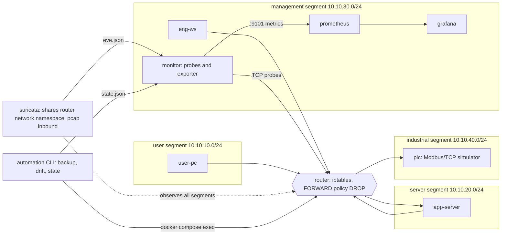
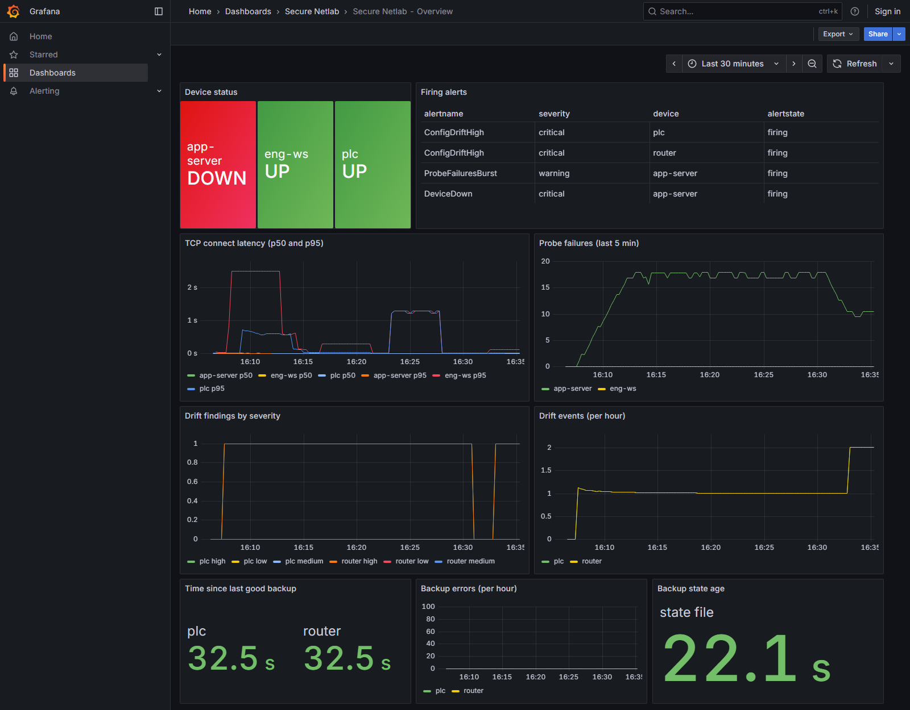
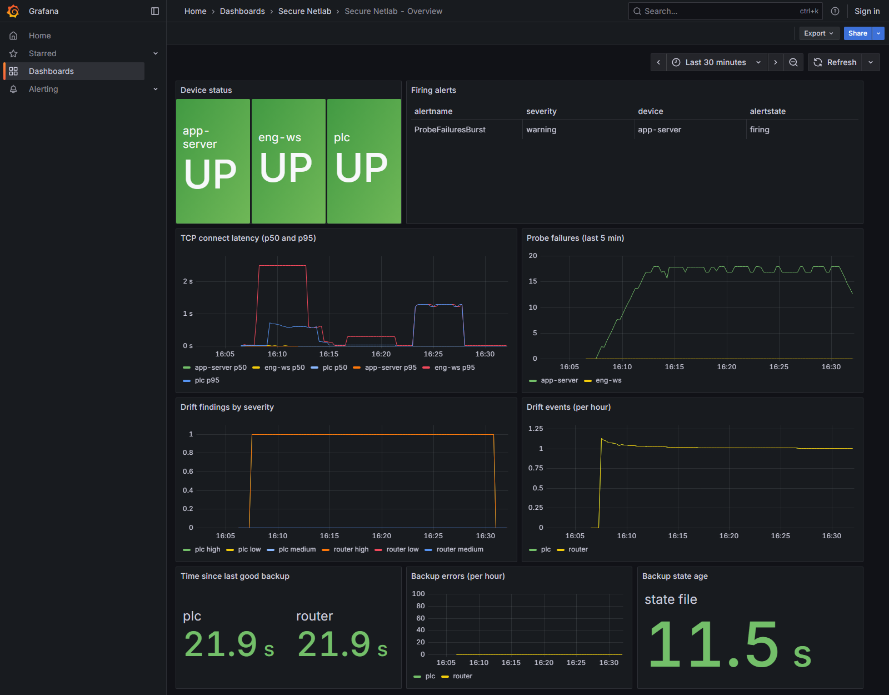

# Secure Network Automation and Monitoring Lab

A reproducible, fully containerised lab for network configuration automation, monitoring, intrusion
detection and threat modelling. Everything runs on your machine, on simulated devices, inside Docker
networks that no other machine can reach.

> **Authorized lab use only.** This project is for learning and for demonstrating defensive techniques
> on simulated devices inside its own Docker networks. Do not point its tools, scanners or traffic
> generators at networks, hosts or devices you do not own or have written permission to test. The
> traffic tool refuses any target outside `10.10.0.0/16`, but that check is a guardrail, not a
> permission system. You are responsible for how you use this code.

## What it demonstrates

| Pillar | What the lab does | Where |
|---|---|---|
| Segmented network | Four segments (user, server, management, industrial) behind a router with a default-deny firewall | `compose/`, `lab/router/` |
| Config automation | Scheduled backups of firewall rules and listeners, versioned storage, drift detection against approved baselines | `automation/`, `golden/`, `docs/config-drift.md` |
| Monitoring and alerting | TCP uptime and latency probes exported to Prometheus, 11 alert rules, provisioned Grafana dashboard | `monitor/`, `lab/prometheus/`, `lab/grafana/` |
| Intrusion detection | Suricata on all segments, 5 custom rules, alerts parsed from `eve.json` into Grafana | `lab/suricata/`, `docs/ids.md` |
| Threat model | Assets, trust boundaries, threats, mitigations and gaps | [Threat model](#threat-model) below |

## Architecture



Nothing in the lab is published to the network. The only host ports are Grafana (3000) and Prometheus
(9090), both bound to `127.0.0.1`.

## Quick start

Requirements: Docker with Compose v2 and Python 3.11 or newer. The first run downloads and builds several images.

```bash
pip install -r requirements-dev.txt   # one time: demo and test dependencies
make demo                             # starts the lab, backs up devices, runs detection traffic
```

On Windows without `make`, run `python scripts/demo.py` instead.

When it finishes, open:

- Grafana dashboard: <http://127.0.0.1:3000/d/lab-overview> (anonymous viewer, localhost only)
- Prometheus alerts: <http://127.0.0.1:9090/alerts>

Stop and remove the lab with `make down`.

Other commands:

| Command | Does |
|---|---|
| `make up` / `make down` | start / stop and remove the lab |
| `make check` | back up all devices and report drift (exit 1 on drift) |
| `make demo-traffic` | run the four detection scenarios |
| `make test` | ruff, unit tests, then integration tests against the running lab |
| `python -m automation run --every 300` | scheduled backups; keeps the monitoring data fresh |

## Screenshots

**Dashboard during the IDS demo.** Firing alerts at the top; IDS alert table and chart at the bottom.


**Prometheus alerts during the IDS demo.** Intrusion detection rules firing.


**Incident in the device layer.** The app server is down and drift is present on the router and the PLC.



**Recovered.** All devices are up with no drift. The probe-failure alert is still in its window.



More detail is in [docs/monitoring.md](docs/monitoring.md) and [docs/ids.md](docs/ids.md).

## Repository layout

```
compose/                 docker-compose.yml: segments, router, endpoints, monitoring, Suricata
lab/router/              router image and default-deny firewall rules (rules.sh)
lab/host/                endpoint image (user PC, app server, engineering workstation)
lab/modbus-sim/          simulated Modbus/TCP PLC (standard library only)
lab/suricata/rules/      custom IDS rules
lab/prometheus/          scrape config and alert rules
lab/grafana/             provisioned datasource and dashboard
lab/tools/               probe and traffic tools that run inside lab containers
automation/              backups, drift detection, versioned storage, CLI
monitor/                 TCP probes, Prometheus exporter, eve.json parser
inventory/               devices to back up
golden/                  approved configuration baselines
scripts/                 one-command demo and detection-traffic runner
tests/                   unit tests, plus tests/integration (needs the running lab)
docs/                    topology, config drift, monitoring, IDS, screenshots
.github/workflows/       CI: lint and unit tests on push, lab integration tests
```

## Testing and CI

- `make test` runs ruff, the unit tests (111, no Docker needed) and the integration tests (26, against
  the live lab). Integration tests cover segment rules, drift against the live devices, Prometheus and
  Grafana, promtool, and each IDS scenario.
- GitHub Actions runs on every push and pull request. The `lint-and-unit` job runs ruff and the unit
  tests. The `lab-integration` job starts the lab on the runner, runs a backup check, runs the
  integration tests, and tears the lab down.
- Configuration is checked before deployment. Alert rules must reference only metrics the exporter
  produces, and the dashboard JSON must use the provisioned datasource.

## Threat model

The lab models a small industrial network: an office segment, an application server, a management
segment for engineers and monitoring, and a PLC on an industrial segment. The threat model covers the
lab as built. Real plants need more than this (see "What the lab does not cover").

### Assets

| ID | Asset | Why it matters | Where it lives |
|---|---|---|---|
| A1 | PLC register values and the ability to write them | Controls the simulated process; writes change behaviour | `lab/modbus-sim` |
| A2 | Router firewall policy | Decides which segments can reach which services | router container |
| A3 | Approved baselines (`golden/`) | The reference for "what should be configured" | git |
| A4 | Backup history (`backups/`) | Evidence of what changed and when | local disk, git-ignored |
| A5 | Alert and IDS evidence (`eve.json`, `state.json`) | Used to detect and investigate incidents | `reports/`, git-ignored |
| A6 | Monitoring and dashboards | How operators see device health and alerts | Prometheus, Grafana |
| A7 | Secrets (`.env`) | Lab credentials | local only; `.env.example` holds fake values |
| A8 | The repository and its CI pipeline | Integrity of the code that runs the lab | GitHub |

### Trust boundaries

- **TB1: segment to segment.** Every packet crossing a segment passes through the router, the only
  forwarding path. Inside a segment there is no filtering.
- **TB2: host to containers.** The only published ports are Grafana and Prometheus, both on
  `127.0.0.1`.
- **TB3: engineering workstation to PLC.** The only segment allowed to write to the PLC is management,
  and only for the Modbus port.
- **TB4: developer to repository to CI.** Code, configuration and pinned image tags enter here.

### Threats and mitigations

| ID | Threat | STRIDE | Asset | Mitigation | Detection | Verified by |
|---|---|---|---|---|---|---|
| T1 | A user-segment host reaches the PLC | Elevation, tampering | A1 | Router default-deny; only the server and management segments may reach 502 | SID 1000001 (any attempt, rate-limited); drift on new allow rules | `test_blocked_flow_is_dropped`, `test_allowed_flow_is_forwarded` |
| T2 | Unauthorised Modbus writes | Tampering | A1 | Only the engineering workstation and historian may reach 502; the PLC simulator answers writes with an exception | SID 1000003 and 1000004 (FC6, FC16) | `test_fc6_request_bytes`, scenario SIDs in `test_ids_live` |
| T3 | A compromised user host scans the server segment | Reconnaissance | A2, A6 | Router drops everything not allow-listed; the scan does not reach the hosts | SID 1000005 (SYN burst from one source) | `test_each_demo_scenario_raises_its_expected_alerts` |
| T4 | Admin protocols (SSH, Telnet) probed from the user segment | Elevation | A2 | No router rule allows them; listeners are checked against baseline | SID 1000002; `listener-added` on sensitive ports | `test_blocked_flow_is_dropped` |
| T5 | Firewall policy weakened (rule added, policy changed) | Tampering | A2, A3 | Golden baseline in git; any change is a finding | `policy-changed` (high), `firewall-rule-added` (high on sensitive ports) | `test_policy_change_is_high_severity`, `test_new_allow_rule_to_modbus_port_is_high` |
| T6 | A new management or industrial service is opened on a device | Elevation | A2 | Listener baseline; new listeners on sensitive ports are high | `listener-added` (high on 22, 23, 80, 443, 502, 830) | `test_closed_management_port_is_low`, drift fixture tests |
| T7 | Monitoring goes silent (exporter or scheduler stops) | Denial of service, repudiation | A5, A6 | Staleness alerts | `DeviceDown`, `BackupStateStale`, `IdsEveStale` | promtool check, live alert test |
| T8 | Evidence altered (`eve.json`, `state.json`) | Tampering, repudiation | A5 | Monitor mounts both read-only; counts are derived from the file on each scrape | none on the file itself | not verified: no integrity protection |
| T9 | Secrets committed to the repo | Information disclosure | A7 | `.env` is git-ignored; `.env.example` values must start with `FAKE-` | none | `test_env_example_secrets_are_fake` |
| T10 | Dashboards exposed to other machines | Information disclosure | A6 | Ports bound to `127.0.0.1`; Grafana anonymous access is viewer-only | none | `test_no_ports_published_to_host` in `test_compose_topology.py` |
| T11 | The traffic tool is pointed at a real network | Misuse | any | Targets must be IP literals in `10.10.0.0/16`; scans capped at 100 ports; payloads limited to two Modbus write requests | none | `test_traffic_tool.py` guard tests |
| T12 | Compromised or drifting container image | Tampering | all | Image tags pinned (Suricata 7.0.11, Prometheus v3.5.0, Grafana 12.1.1, Python 3.12-alpine3.20, Alpine 3.20) | none | pinned in `compose/` and `Dockerfile`s |
| T13 | Malicious change to code or CI | Tampering | A8 | Lint and tests on every push; the lab test job runs before merge | CI status | `.github/workflows/ci.yml` |
| T14 | Suricata has access to all traffic | Information disclosure | A5 | Suricata shares the router namespace and holds only `NET_RAW`; logs are written to a dedicated directory | none | not verified |

### What the lab does not cover

These are known gaps, not oversights:

- **Real devices and protocols.** The PLC simulates Modbus/TCP function codes 3, 6 and 16 only. There is
  no authentication, encryption or TLS, and no real vendor firmware. Real Modbus and most OT protocols
  have no authentication at all.
- **Traffic inside a segment.** The IDS sits on the router, so traffic between two hosts on the same
  segment is invisible.
- **Inline blocking.** Suricata detects. The router enforces. Nothing sits inline, and no IPS mode is
  configured.
- **Encrypted and fragmented traffic.** Rules match plaintext packets at fixed offsets. Fragmentation
  evasion and TLS are not analysed.
- **Config management over SSH.** Backups use `docker compose exec`, not SSH or Netmiko, so credential
  handling and SSH host keys are not exercised.
- **Alert delivery.** Alerts are evaluated and shown in Prometheus and Grafana. Alertmanager and
  paging are not configured.
- **Who made a change.** There is no audit trail beyond the drift record. Real systems need change
  approval and per-user audit logs.
- **Integrity of evidence.** `eve.json` and `state.json` are plain files. There is no signing, WORM
  storage or log shipping to a separate system.
- **Availability.** A single router is a single point of failure. The lab has no high availability, no
  rate limiting on the router, and no resilience testing.
- **User segment monitoring.** The monitor runs on the management segment and cannot probe the user
  segment, by design.
- **Authentication on the monitoring stack.** Prometheus has no authentication. Grafana allows
  anonymous viewing. Both depend on the localhost binding for protection.
- **Remote CI.** The workflow has been validated locally (YAML parsing, and ruff and unit tests in a
  `python:3.11` container) but had not run on GitHub when this README was written.

## Sample incident response walkthrough

This is what the lab does when someone adds an unauthorised route to the PLC. The steps were run
against the live lab. The IP addresses and rule text are from that run.

**Scenario.** A rule is added to the router allowing the user segment to reach the PLC on port 502. A
user PC then reads the PLC registers and writes to one.

**1. Change.** An operator adds the rule:

```text
iptables -I FORWARD 1 -s 10.10.10.0/24 -d 10.10.40.0/24 -p tcp --dport 502 -j ACCEPT
```

**2. Detection by config drift.** The next scheduled backup compares the router with its baseline:

```text
DRIFT router: 1 finding(s)
  [HIGH] firewall-rule-added: -A FORWARD -s 10.10.10.0/24 -d 10.10.40.0/24 -p tcp -m tcp --dport 502 -j ACCEPT
```

Prometheus fires `ConfigDriftHigh` (critical) for the router. The dashboard shows the drift finding
within one scrape interval.

**3. Activity.** The user PC reads and writes the PLC registers. Both succeed because the rule allows
them:

```text
user-pc: probe modbus 10.10.40.10  ->  1200 480 3 25 0 0 1 42
user-pc: modbus fc6 10.10.40.10    ->  exception 1
```

Suricata records the activity independently of the firewall. The unexpected source triggers SID
1000001 (unexpected connection into the industrial segment). The write triggers SID 1000003 (Modbus
write, FC 6). Prometheus fires `IdsHighSeverityAlert` (critical) for each.

**4. Triage.** The responder starts from the alerts and reads the evidence:

```text
# which alerts fired, from which source, to which port
Get-Content reports/suricata/eve.json | Where-Object { $_ -match '"event_type":"alert"' }

09:17:22 sid=1000001 10.10.10.10 -> 10.10.40.10:502  LAB unexpected connection attempt into industrial segment
09:17:49 sid=1000003 10.10.10.10 -> 10.10.40.10:502  LAB Modbus write single register (FC06) to PLC
```

The responder then confirms the scope:

- **Which rule changed?** The drift report names it. No other finding is present.
- **Did the PLC change?** The PLC's listener baseline is unchanged. The write was answered with an
  exception, so no register value changed. In a real plant, check the process values and the
  historian.
- **Who else is affected?** Only the user segment appears as a source. Rate limits are per rule and per
  source, so repeated attempts from one source within 30 s produce one SID 1000001 alert, not one per
  packet.

**5. Containment.** The responder removes the rule, which restores default-deny for that flow:

```text
iptables -D FORWARD -s 10.10.10.0/24 -d 10.10.40.0/24 -p tcp --dport 502 -j ACCEPT
```

A repeat write now gets no answer:

```text
user-pc: connect 10.10.40.10:502  ->  no answer
```

**6. Recovery and verification.** A fresh backup check shows no drift. The drift alert clears once the state file is
updated and Prometheus scrapes it:

```text
router: unchanged
OK router: no drift
```

The IDS alerts stay firing until the five-minute `increase()` window passes, which is expected.

**7. Lessons.** The lab shows the value of pairing detective controls. Drift caught the change, and the
IDS recorded the traffic that used it. Neither depended on the other. Real improvements would be:

- route `ConfigDriftHigh` and `IdsHighSeverityAlert` to a paging system (the lab has no Alertmanager);
- require change approval for router rules and check the drift against the approved change ticket;
- record who made the change (the lab cannot, because it has no audit log);
- consider blocking SID 1000003 inline, and document the trade-off for OT systems, where a blocked
  write can affect process safety.

## License

MIT. See [LICENSE](LICENSE).
