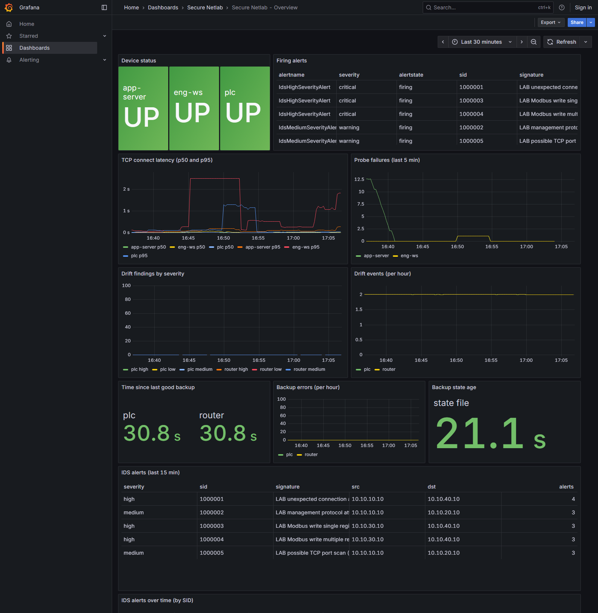
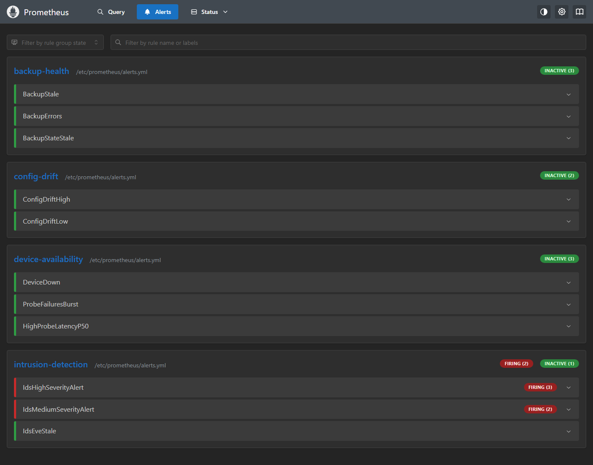

# Intrusion detection (Phase 4)

Suricata watches traffic on all four lab segments. Custom rules flag unexpected traffic into the
industrial segment, Modbus writes, management-protocol attempts from the user segment, and port-scan
patterns. Alerts are parsed from `eve.json`, shown in Grafana, and fed to Prometheus alert rules.

Everything is simulated, on the lab networks, and triggered only by the harmless traffic in
`scripts/demo_traffic.py`.

## Architecture

```
user-pc, eng-ws, app-server, plc  --->  router (forwards between segments, FORWARD policy DROP)
                                           ^
                                           | suricata shares the router's network namespace
                                           | pcap on "any", BPF filter "inbound"
                                       suricata --> reports/suricata/eve.json
                                                        |  (read-only mount)
                                                    monitor (exporter, lab_ids_* metrics)
                                                        |
                                                    prometheus (IDS alert rules)
                                                        |
                                                    grafana (IDS table and chart)
```

- **Where Suricata sits:** in the router's network namespace (`network_mode: service:router`). It
  sees every packet the router receives, on every segment, including packets the router then drops.
  Detecting an attempt does not depend on the firewall letting it through.
- **One copy per packet:** pcap mode on `any` with the BPF filter `inbound` captures each packet once,
  on its arrival interface. Without the filter, every forwarded packet would also be seen leaving the
  other interface, and every alert would be counted twice. A test confirms this: one allowed Modbus write
  gives one alert.
- **Limit:** traffic inside one segment never reaches the router, so it is invisible here. A scan from
  inside the user segment to another user host would not be detected.

## Rules (`lab/suricata/rules/lab.rules`)

| SID | Priority | Detects | Notes |
|---|---|---|---|
| 1000001 | high | any connection attempt into the industrial segment from a host not on the allow list | allow list: app-server, eng-ws, monitor. Rate limit: one alert per source per 30 s |
| 1000002 | medium | SSH/Telnet attempts from the user segment | rate limit: one per source per 30 s |
| 1000003 | high | Modbus write single register (FC 0x06) to the PLC | rate limit: one per source per 5 s |
| 1000004 | high | Modbus write multiple registers (FC 0x10) to the PLC | rate limit: one per source per 5 s |
| 1000005 | medium | port-scan pattern: 20+ SYNs from one source within 10 s | `threshold: type both`, one alert per window |

The rules are matched against the lab's own addresses, so they won't fire on anything outside the lab.

## Running the demo

```bash
make up                           # starts everything, including suricata
make demo-traffic                 # runs all four scenarios
python scripts/demo_traffic.py port-scan   # or one scenario at a time
```

| Scenario | Source | What it does | Expected SID |
|---|---|---|---|
| unexpected-industrial | user-pc | one TCP connect to the PLC (the router drops it) | 1000001 |
| management-attempt | user-pc | one TCP connect to app-server port 22 (dropped) | 1000002 |
| modbus-write | eng-ws | Modbus FC 6 and FC 16 writes to the PLC; the PLC answers with exception 1 and changes nothing | 1000003, 1000004 |
| port-scan | user-pc | 60 connection attempts to app-server ports 1-60 | 1000005 |

Safety rules, enforced in code (`lab/tools/traffic.py`):
- Targets must be IP addresses in `10.10.0.0/16`. Anything else raises an error.
- A scan is capped at 100 ports, with a 1-second timeout.
- The only payloads are two Modbus write requests. The PLC simulator does not implement writes.
  These do not exploit anything. They are the requests the rules are written to catch.

## Dashboard and alerts



*Firing alerts (top) and the IDS panels (bottom) after `make demo-traffic`. The table shows signature,
severity, source, destination and count for the last 15 minutes.*



*Prometheus: IdsHighSeverityAlert and IdsMediumSeverityAlert firing.*

Prometheus alert rules (`lab/prometheus/alerts.yml`, group `intrusion-detection`):
- **IdsHighSeverityAlert** (critical): a priority-1 SID fired in the last 5 minutes.
- **IdsMediumSeverityAlert** (warning): a priority-2 SID fired in the last 5 minutes.
- **IdsEveStale** (warning): eve.json has not been written for 5 minutes. Suricata writes stats events
  every few seconds, so a stale file means the engine has stopped.

Exported metrics: `lab_ids_alerts_total{signature,sid,severity,src,dst}` and
`lab_ids_eve_age_seconds`. The monitor counts alerts from `eve.json` on each scrape, so the counts
survive restarts and stay consistent with the file.

## Decisions and what went wrong

- **Pcap on `any`, not AF_PACKET per interface.** AF_PACKET needs one socket per interface, and each
  forwarded packet would be seen twice. Pcap with the `inbound` filter avoids this.
- **`-k none` (checksum validation off).** Packets captured before checksum offload can look invalid
  inside a VM. Validation would drop real traffic silently. This is a deliberate lab trade-off.
- **`NET_RAW` only.** The image's entrypoint runs as root and skips its permission fix-up when it has
  no `NET_ADMIN`/`SYS_NICE`. That fix-up chowns the log directory, which failed on the bind mount.
- **Rate limits instead of one alert per packet.** A single connect gives a SYN and a retransmit, so
  without a limit one attempt would produce two alerts. The scan rule once fired on every SYN after the
  threshold (about 40 alerts per scan), so it uses `threshold: type both` instead.
- **A rule failed silently after an edit.** Combining `detection_filter` with `threshold` in one rule
  is rejected by Suricata. The engine kept running without the scan rule, and I only noticed because
  the scan alert count was zero. The check that now catches this is the integration test that requires
  "5 rules successfully loaded, 0 rules failed".

## Limitations

- **Detection only.** Suricata raises alerts. The router still does the blocking. Nothing is inline.
- **Intra-segment traffic is not visible** (see architecture).
- **eve.json is reparsed on every scrape.** Fine for a lab-sized log. At scale, it would need an
  incremental reader or a log shipper such as Loki.
- **Rate limits hide repeats.** Within 30 s, a second attempt from the same source does not alert.
- **No Modbus protocol state tracking.** Rules match single packets and fixed byte offsets.
- **Severity is set by the rule's `priority` keyword** and is only as good as the rule choice.

## Tests

- `tests/test_ids.py`: eve.json parsing, skipping of non-alert events, and the collector's output.
- `tests/test_traffic_tool.py`: the lab-only guard, port bounds, Modbus request bytes, and that every
  demo target is inside the lab.
- `tests/test_suricata_rules.py`: rule syntax, unique SIDs in the lab range, the industrial allow list
  matching the topology, and every demo SID existing as a rule.
- `tests/integration/test_ids_live.py`: the engine loads all rules with 0 failures, the engine is running
  and writing eve.json, each scenario raises its expected SIDs, the monitor's probes do not trigger the
  industrial rule, and Prometheus shows the counts.
