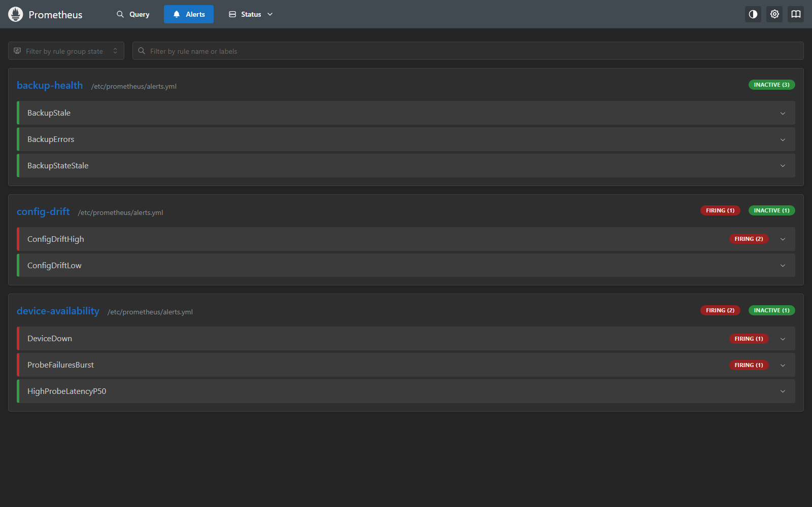

# Monitoring and alerting (Phase 3)

Uptime and latency probes, Prometheus metrics, alert rules, and a provisioned Grafana dashboard.
Everything runs in the Compose lab on the management segment.

## Architecture

```
  monitor (10.10.30.20)            probes eng-ws:8080, app-server:8080, plc:502
     | :9101 /metrics                 (crosses the router, allowed by the segment rules)
     |                              reads reports/state.json (written by `automation check|run`)
  prometheus (10.10.30.30)         scrapes monitor every 15 s, evaluates lab/prometheus/alerts.yml
     |
  grafana (10.10.30.40)            provisioned datasource + dashboard (lab/grafana)
```

- Prometheus UI: http://127.0.0.1:9090 (alerts at `/alerts`)
- Grafana: http://127.0.0.1:3000, dashboard "Secure Netlab - Overview"
- Both are bound to 127.0.0.1, so they are not reachable from other machines.

## Metrics

| Metric | Type | Source | Meaning |
|---|---|---|---|
| `lab_device_up{device}` | gauge | probe loop | 1 if the last TCP connect succeeded |
| `lab_probe_duration_seconds{device}` | histogram | probe loop | connect time of successful probes |
| `lab_probe_failures_total{device}` | counter | probe loop | failed probes |
| `lab_probes_total{device}` | counter | probe loop | probes attempted |
| `lab_drift_events_total{device}` | counter | state file | drift events (new or changed findings) |
| `lab_drift_findings{device,severity}` | gauge | state file | findings in the latest check |
| `lab_backup_versions_total{device}` | counter | state file | config versions stored |
| `lab_backup_errors_total{device}` | counter | state file | failed backup attempts |
| `lab_backup_last_success_timestamp_seconds{device}` | gauge | state file | last successful backup |
| `lab_state_age_seconds` | gauge | state file | seconds since the scheduler last wrote state (+Inf if never) |

The probe is a TCP handshake, so it needs no application logic and works for both the web app and the
Modbus PLC. Counters in the state file are cumulative and survive restarts.

## Alert rules (`lab/prometheus/alerts.yml`)

| Alert | Severity | Fires when |
|---|---|---|
| DeviceDown | critical | a device fails TCP probes for 1 minute |
| ProbeFailuresBurst | warning | more than 3 failed probes in 10 minutes |
| HighProbeLatencyP50 | warning | median connect time above 50 ms for 5 minutes |
| ConfigDriftHigh | critical | a high-severity drift finding (management port or policy) |
| ConfigDriftLow | warning | medium or low drift findings |
| BackupStale | warning | no successful backup for 15 minutes |
| BackupErrors | warning | any backup failure in 30 minutes |
| BackupStateStale | warning | the scheduler has not written state for 15 minutes |

## Dashboard


*Incident: app-server stopped and drift injected on the router and the PLC. Firing alerts: DeviceDown,
ProbeFailuresBurst, and ConfigDriftHigh on two devices.*


*After recovery: all devices UP, no drift. ProbeFailuresBurst is still firing because its 10-minute
window has not passed since the outage.*



*Prometheus alerts page during the same incident.*

Panels: device status, firing alerts, latency p50 and p95, probe failures, drift findings by
severity, drift events per hour, time since last good backup, backup errors, state file age.

## Running it

```bash
make up                                  # starts the whole lab, including monitoring
python -m automation run --every 60      # scheduler: backs up, updates reports/state.json
make integration                         # includes the Prometheus and Grafana checks
```

The scheduler runs on the host because it needs `docker compose exec` to reach the devices. Run it in
a terminal, or register `python -m automation check` with cron or Task Scheduler. Without it, the
backup state goes stale and BackupStateStale fires.

## Findings

- **Latency spikes:** about 8% of TCP connects to eng-ws and the PLC take roughly 1 s. That is close to the
  kernel's initial SYN retransmission timeout, so the likely cause is packet loss in the Docker Desktop
  VM network. I did not prove the cause. Because of it, p95 sits at the top bucket and would alert all the
  time, so the alert uses the median and the dashboard shows both.
- **Probe failures during an outage:** while app-server was stopped, the router answered probes with
  "host unreachable" and the monitor counted them as failures. DeviceDown and ProbeFailuresBurst both fired.

## Limitations

- **No Alertmanager.** Alerts are evaluated and shown in Prometheus and Grafana, but not sent to email,
  chat or a pager. Adding Alertmanager with a receiver is the next step.
- **The user segment is not monitored.** The monitor sits on the management segment, which the router
  does not allow to reach user (10.10.10.0/24). Monitoring it would need a new allow rule, which is a
  design decision.
- **Anonymous Grafana viewer access.** This is for convenience and the screenshots. It is safe only
  because the port is bound to 127.0.0.1. Editing requires the admin login (`GRAFANA_ADMIN_PASSWORD`).
- **Compose variables.** Compose reads `.env` from the directory of the compose file (`compose/`), not
  the repo root. Without it, Grafana falls back to the fake default password from the compose file.
- **Latency alert threshold.** The 50 ms median threshold is a lab value chosen to avoid the SYN spikes.
  It has not been tuned against real device latency.

## Tests

- `tests/test_monitor.py`: probe logic, exporter output, probe loop, exported families vs the declared list.
- `tests/test_state.py`: event counting, error handling, atomic state writes.
- `tests/test_observability_config.py`: alert and dashboard YAML/JSON is valid, and every metric name used
  in an alert or panel is exported by the monitor.
- `tests/integration/test_monitoring_live.py`: promtool passes on the config, Prometheus scrapes all
  three probes, alert rules evaluate, backup metrics reach Prometheus, Grafana serves the dashboard.
